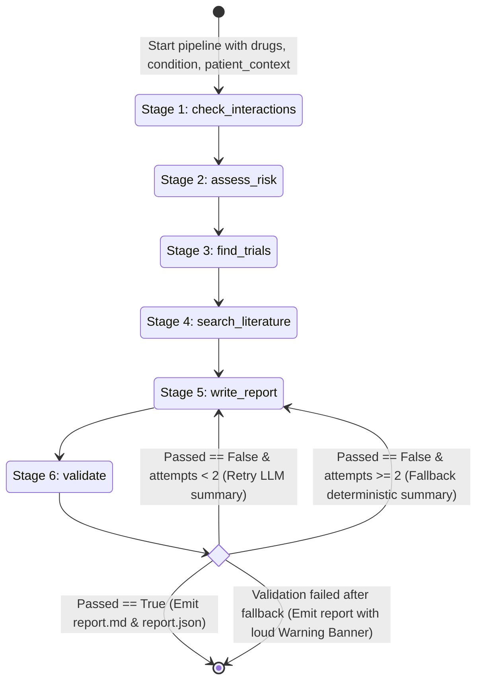
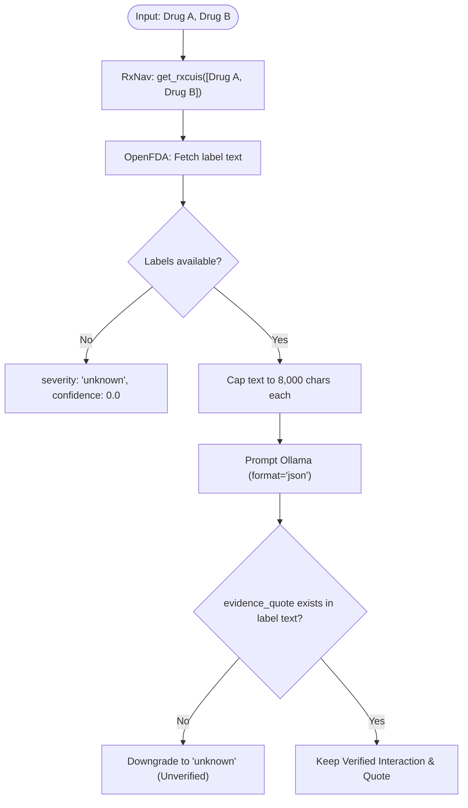
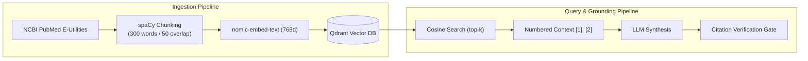
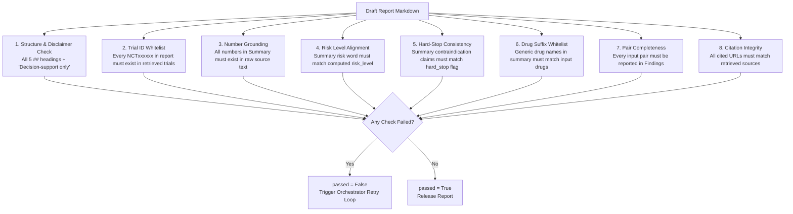
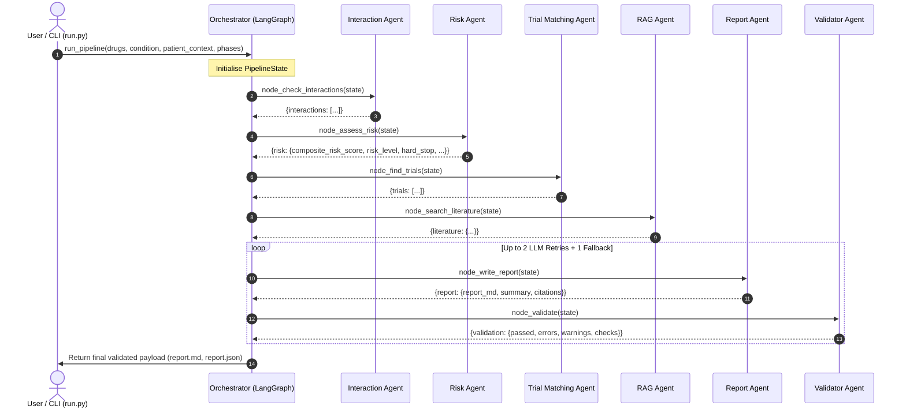
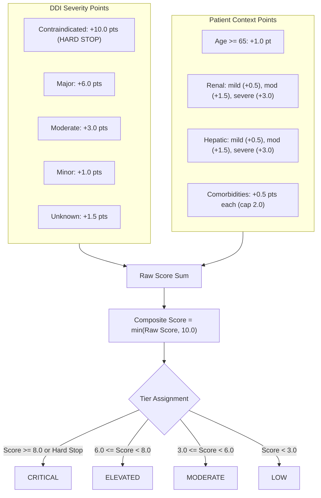

# DrugTrialAI: Comprehensive Technical & Architectural Report

**Project Title:** Multi-Agent Autonomous Clinical Trial & Drug Interaction Analyzer  
**Target Domain:** Clinical Pharmacology, Drug-Drug Interaction (DDI) Safety, Clinical Trial Matching, and Grounded RAG Reporting  
**Version:** 0.1.0  
**Stack Paradigm:** 100% Free / Open-Source Local-First & Public API Architecture  

---

## Executive Summary

**DrugTrialAI** is an autonomous multi-agent backend system designed to solve three critical challenges in clinical pharmacology and clinical trial recruitment:
1. **Accurate Drug-Drug Interaction (DDI) Detection:** Identifying interaction mechanisms, clinical significance, and severity levels between prescribed medications based on authoritative FDA drug package inserts and RxNav ontologies.
2. **Clinical Trial Semantic Matching:** Discovering recruiting clinical trials on ClinicalTrials.gov that align with a patient's medical condition, age, organ function, and comorbidities.
3. **Strictly Grounded, Auditable Reporting:** Synthesizing findings into a structured, clinician-facing report where every factual claim is strictly tied to retrieved evidence (FDA labels, PubMed literature, registered clinical trials), backed by a deterministic validation engine that programmatically rejects model hallucinations.

A foundational architectural principle of DrugTrialAI is that **safety decisions are never delegated to raw LLM memory**. The system employs a deterministic rule engine for risk scoring, a strict quote-verification mechanism against raw FDA label texts, and an 8-rule post-generation validation gate. The Large Language Model (LLM) is restricted to linguistic synthesis, explanatory summaries, and contextual parsing.

---

## 2. Technology Stack & Design Principles

DrugTrialAI operates entirely on a **$0 free-tier local/hybrid stack**:

| Layer | Component | Implementation | Role & Justification |
|---|---|---|---|
| **Multi-Agent Orchestration** | LangGraph (`>=1.2.20`) | `core_engine/agents/orchestrator.py` | StateGraph DAG with conditional edges, state propagation, and validation retry loops. |
| **Local LLM Inference** | Ollama (`>=0.6.3`) | `core_engine/integrations/llm_client.py` | Local execution of models like `phi3:mini` or `llama3.1`. Zero API fees and no external data leakage. |
| **Local Embeddings** | Ollama `nomic-embed-text` | `core_engine/rag/embeddings.py` | High-quality 768-dimensional clinical and document embeddings for vector search. |
| **Vector Database** | Qdrant Client (`>=1.19.1`) | `core_engine/rag/vector_store.py` | Persistent local vector store (`clinical_documents` collection, cosine distance). |
| **DDI Data Source** | NLM RxNav REST API | `core_engine/integrations/rxnav_client.py` | Resolves standard RxCUIs for drug names via `approximateTerm.json`. |
| **FDA Label Data** | OpenFDA Drug Label API | `core_engine/integrations/openfda_client.py` | Official FDA package inserts (`drug_interactions` section). |
| **Clinical Trials** | ClinicalTrials.gov REST v2 | `core_engine/integrations/clinicaltrials_client.py` | Official query endpoint for recruiting human clinical studies. |
| **Biomedical Literature** | NCBI Entrez E-Utilities | `core_engine/integrations/pubmed_client.py` | ESearch & EFetch XML endpoints for PubMed abstracts. |
| **NLP & Text Chunking** | spaCy (`>=3.8.16`) | `core_engine/rag/chunking.py` | Sentence boundary detection using `en_core_web_sm` with sliding window word overlap. |
| **Runtime & Packaging** | Python 3.13 & `uv` | `pyproject.toml`, `uv.lock` | Ultra-fast dependency resolution and virtual environment management. |

---

## 3. High-Level Architecture & Component Map

The architecture separates orchestration, domain-specific agent reasoning, local inference, and external public data providers.

### Architectural Diagram

```mermaid
graph TB
    subgraph ClientLayer ["1. Client & Invocation Layer"]
        CLI["CLI Entrypoint (run.py)"]
        API["FastAPI Gateway (Target / Future)"]
    end

    subgraph OrchestrationLayer ["2. Multi-Agent Orchestrator (LangGraph)"]
        Orchestrator["Orchestrator Engine (core_engine/agents/orchestrator.py)"]
        State["Shared State: PipelineState (TypedDict)"]
    end

    subgraph AgentLayer ["3. Specialized Agent Cluster"]
        InteractionAgent["Drug Interaction Agent\n(OpenFDA + RxNav + LLM)"]
        RiskAgent["Risk Assessment Agent\n(Deterministic Rules + LLM)"]
        TrialAgent["Trial Matching Agent\n(ClinicalTrials.gov API v2)"]
        RAGAgent["Literature RAG Agent\n(PubMed + Vector Retrieval)"]
        ReportAgent["Report Assembler Agent\n(Structured Generator + LLM Summary)"]
        ValidatorAgent["Validator & Critic Agent\n(Anti-Hallucination Gate)"]
    end

    subgraph LocalInference ["4. Free Local Inference & Vector Layer"]
        OllamaLLM["Local LLM: Ollama (phi3:mini / llama3.1)"]
        OllamaEmbed["Local Embeddings: nomic-embed-text (768d)"]
        QdrantDB[("Qdrant Vector DB\n(Collection: clinical_documents)")]
    end

    subgraph ExternalSources ["5. External Public APIs ($0 Free Tier)"]
        RxNavAPI["NLM RxNav REST API\n(RxCUI resolution)"]
        OpenFDAAPI["OpenFDA Drug Label API\n(Official Package Inserts)"]
        ClinTrialsAPI["ClinicalTrials.gov REST API v2\n(Active Studies & Protocols)"]
        PubMedAPI["NCBI Entrez E-Utilities\n(ESearch + EFetch XML)"]
    end

    subgraph OutputLayer ["6. Verified Deliverables & Audit Trail"]
        ReportMD["report.md (Clinician Markdown Report)"]
        ReportJSON["report.json (Audit Trail & Structured Payload)"]
    end

    CLI --> Orchestrator
    API -.-> Orchestrator
    Orchestrator <--> State

    Orchestrator --> InteractionAgent
    Orchestrator --> RiskAgent
    Orchestrator --> TrialAgent
    Orchestrator --> RAGAgent
    Orchestrator --> ReportAgent
    Orchestrator --> ValidatorAgent

    InteractionAgent --> RxNavAPI
    InteractionAgent --> OpenFDAAPI
    InteractionAgent --> OllamaLLM

    RiskAgent --> OllamaLLM
    TrialAgent --> ClinTrialsAPI

    RAGAgent --> QdrantDB
    RAGAgent --> OllamaEmbed
    RAGAgent --> OllamaLLM

    ReportAgent --> OllamaLLM

    ValidatorAgent --> Orchestrator
    Orchestrator --> ReportMD
    Orchestrator --> ReportJSON
```



---

## 4. Multi-Agent Pipeline & Orchestration Flow

The pipeline is modeled as a compiled LangGraph `StateGraph`. Execution is sequential rather than parallel because local LLM execution on Ollama is compute-bound on standard hardware.

### LangGraph Execution DAG & State Machine



### Shared State Lifecycle: `PipelineState`

The state passed across all nodes is defined in `core_engine/agents/orchestrator.py`:

```python
class PipelineState(TypedDict, total=False):
    # Inputs
    drugs: list[str]
    condition: str | None
    patient_context: dict
    phases: list[str] | None
    
    # Agent Outputs
    interactions: list[dict]
    risk: dict | None
    trials: list[dict]
    literature: dict | None
    report: dict
    validation: dict
    
    # Bookkeeping & Resilience
    report_attempts: int
    used_fallback_summary: bool
    stage_errors: list[str]
```

#### Fault Tolerance & Stage Error Isolation
If an agent stage throws an uncaught exception (e.g. PubMed network timeout or ClinicalTrials endpoint outage), the orchestrator catches it using `_with_error()`. The error is logged, appended to `stage_errors`, and the pipeline continues gracefully with empty defaults rather than crashing the run.

---

## 5. Detailed Agent Subsystems

### 5.1. Drug Interaction Agent (`interaction_agent.py`)

The Interaction Agent evaluates all unique pairwise combinations of the input drugs ($\binom{n}{2}$ pairs).

#### The Clinical Pharmacology Challenge
FDA drug labels frequently do not cite individual co-prescribed drugs by brand or chemical name. Instead, they reference **drug classes** (e.g., *oral anticoagulants*, *CYP3A4 inhibitors*, *macrolide antibiotics*, *NSAIDs*). A simple string search fails, while an unconstrained LLM often fabricates interactions.

#### The Quote Verification Solution
The interaction agent uses a two-phase protocol:
1. **Extraction:** The LLM is supplied with up to 8,000 characters of the official FDA label "Drug Interactions" section for both drugs. The prompt instructs the model to match either direct drug names or pharmacologic classes. The model is forced to return an exact `evidence_quote`.
2. **Verification (`_quote_is_supported`):** The Python code normalizes whitespace, unicode quotes, and case, then verifies whether the claimed `evidence_quote` is present verbatim in either drug's FDA label text.
   - If the quote is missing or fabricated $\rightarrow$ the finding is rejected and marked `severity: "unknown"` with confidence `0.0`.
   - If `interaction_found: false` $\rightarrow$ severity is forced to `"none"`.



---

### 5.2. Deterministic Risk Assessment Agent (`risk_agent.py`)

Safety-critical risk scoring is completely isolated from generative LLM decisions.

#### Scoring Formulation
The composite risk score is calculated using deterministic arithmetic:

$$\text{Composite Score} = \min\left(10.0, \, S_{\text{interactions}} + S_{\text{age}} + S_{\text{renal}} + S_{\text{hepatic}} + S_{\text{comorbidities}}\right)$$

Where:
- **Interaction Severity Weights ($S_{\text{interactions}}$):**
  - `contraindicated`: **10.0** (triggers immediate `hard_stop = True`)
  - `major`: **6.0**
  - `moderate`: **3.0**
  - `minor`: **1.0**
  - `unknown`: **1.5**
  - `none`: **0.0**
- **Patient Context Weights:**
  - $S_{\text{age}}$: **+1.0** if $\text{age} \ge 65$, else **0.0**
  - $S_{\text{renal}}$: `mild_impairment` (+0.5), `moderate_impairment` (+1.5), `severe_impairment` (+3.0)
  - $S_{\text{hepatic}}$: `mild_impairment` (+0.5), `moderate_impairment` (+1.5), `severe_impairment` (+3.0)
  - $S_{\text{comorbidities}}$: **+0.5** per diagnosed comorbidity, capped at **2.0**

#### Risk Tiers
- **CRITICAL:** Score $\ge 8.0$ OR `hard_stop == True`
- **ELEVATED:** $6.0 \le \text{Score} < 8.0$
- **MODERATE:** $3.0 \le \text{Score} < 6.0$
- **LOW:** $\text{Score} < 3.0$

The LLM is invoked only *after* the score and risk tier are fixed, with a prompt constrained to: *"Explain WHY the risk score is what it is based ONLY on the data below. Do not invent any facts."*

---

### 5.3. Clinical Trial Matching Agent (`trial_matching_agent.py` / `clinicaltrials_client.py`)

The trial matching subsystem queries the ClinicalTrials.gov REST API v2 using targeted filters:
- `query.cond`: Medical condition (e.g., *"Atrial Fibrillation"*).
- `query.intr`: Drug names or interventions.
- `filter.advanced`: Filter expressions for phases (e.g. `AREA[Phase]PHASE2 OR AREA[Phase]PHASE3`).
- `filter.overallStatus`: `RECRUITING`.

#### Protocol Modules Extracted
The raw response payload is parsed into standardized modules:
- `identificationModule`: NCT ID (`nctId`), brief title.
- `statusModule`: Overall recruitment status.
- `designModule`: Study phase, allocation, intervention model.
- `conditionsModule`: Target disease classifications.
- `eligibilityModule`: Inclusion/exclusion criteria, minimum age, maximum age, sex.
- `armsInterventionsModule`: Drug intervention names and arms.

Matches are evaluated against the patient profile (age bounds, sex, and condition) to generate an `eligibility_match_score` (0.0 to 1.0) and explain potential exclusions.

---

### 5.4. Literature RAG Agent & Vector Pipeline (`rag_agent.py`, `retriever.py`, `vector_store.py`)

The Literature RAG pipeline augments the FDA label data with peer-reviewed medical publications.



#### Grounding & Citation Verification
1. Chunks are formatted as numbered entries: `[1] Title (URL) ... Text`.
2. The LLM is commanded to cite statements like `[1]` and explicitly instructed: *"If the sources do not contain enough information to answer, reply exactly: 'The retrieved literature does not contain enough information to answer this.'"*
3. The RAG agent inspects all bracketed numbers `[n]`:
   - Citations referencing nonexistent indices ($n < 1$ or $n > k$) are tagged as `invalid_citations`.
   - If invalid citations are detected, the orchestrator sanitizes the literature answer before it reaches the final report, preventing hallucinated citations from polluting the report.

---

### 5.5. Report Generation & Summary Agent (`report_agent.py`)

To ensure structural consistency and prevent LLMs from hallucinating findings:
1. **Factual Sections are Code-Generated:** The sections for `## Drug Interaction Findings`, `## Risk Assessment`, `## Matching Clinical Trials`, and `## Literature Evidence` are built in deterministic Python string formatting directly from the state dictionaries. The LLM has zero ability to edit severity words, risk scores, or NCT trial IDs.
2. **LLM Writes Only the Summary:** The LLM is provided with a curated bullet list of facts and tasked with generating a 3-4 sentence plain-language clinical summary.
3. **Deterministic Fallback Summary:** If the LLM summary fails to generate or fails subsequent validation, the agent switches to `_fallback_summary()`, which deterministically renders:
   ```text
   Overall risk level is {level}. A contraindicated combination was identified.
   {found} of {total} drug pair(s) showed an interaction. {trial_count} matching trial(s) were found.
   ```
   This fallback is guaranteed to pass the validator by construction.

---

### 5.6. Validator & Critic Agent (`validator_agent.py`)

The Validator Agent acts as an automated compliance auditor. It subjects the final `report_md` to 8 deterministic verification checks:



If validation fails, the orchestrator retries report generation up to `MAX_LLM_SUMMARY_ATTEMPTS` (2 times). On continued failure, it enforces the deterministic summary. If errors still persist, it prepends a prominent warning banner to the final markdown:
```markdown
> ⚠️ **VALIDATION FAILED — do not rely on this report.**
> - Summary contains number(s) not found in the source data: 9.2
```

---

## 6. Embedded Visual Architecture Reference (`diagram.md`)

Below is the complete set of operational diagrams capturing every tier of the system:

### 6.1. Complete Sequence of Inter-Agent Execution


### 6.2. Risk Scoring Decision Matrix


---

## 7. Codebase Health, Static Audit & Findings

A comprehensive scan of the repository was performed across all modules. In accordance with user instructions, **no code was altered**. Below are the key structural findings, anomalies, and architectural observations:

### 7.1. Critical Codebase Anomaly: `trial_matching_agent.py`
* **Observation:** In the current unstaged working directory, the file `core_engine/agents/trial_matching_agent.py` contains unit tests for `interaction_agent.py` (`def test_exact_quote_is_supported()`, etc.) instead of the trial matching agent logic.
* **Impact:** In the working tree, `from core_engine.agents.trial_matching_agent import find_matching_trials` fails to import because `find_matching_trials` is missing.
* **Root Cause & History:** Git diff reveals that `trial_matching_agent.py` was unintentionally overwritten during local testing. The original implementation (which correctly invokes `search_trials` from `integrations.clinicaltrials_client` and computes eligibility matches) is preserved intact in git commit `6a5b705`.
* **Recommendation:** Run `git checkout 6a5b705 -- core_engine/agents/trial_matching_agent.py` and move the test functions to a dedicated file in `tests/test_interaction_agent.py`.

### 7.2. Stubbed and Unimplemented Modules
* **`core_engine/config.py`**: The file is completely empty (0 bytes). Configuration values (`OLLAMA_HOST`, `OLLAMA_MODEL`, `QDRANT_URL`, `NCBI_API_KEY`) are currently read directly via `os.getenv()` in individual integration modules.
* **`core_engine/db/session.py`**: Empty (0 bytes). Relational database session management (PostgreSQL / SQLite) is currently uninitialized.
* **`core_engine/models/db_models.py` & `schemas.py`**: Empty (0 bytes). Typed dictionaries (`TypedDict`) are currently used in `orchestrator.py` instead of Pydantic schemas or SQLAlchemy ORM classes.
* **`core_engine/integrations/dailymed_client.py`**: Empty (0 bytes). DailyMed SPL lookup is listed in the README architecture, but currently OpenFDA handles all drug label fetching.

### 7.3. Legacy Commented Code Blocks
* Several modules (`core_engine/agents/interaction_agent.py`, `core_engine/agents/report_agent.py`, `core_engine/integrations/llm_client.py`) contain extensive commented-out legacy code blocks at the top of the file, followed by the active implementation below.
* **Recommendation:** Remove the commented blocks once git history serves as the audit log to improve code cleanliness.

### 7.4. Test Suite Structure
* The `tests/` directory is currently empty.
* Test code is embedded as standalone `if __name__ == '__main__':` test runners at the bottom of agent files, or inside `test.py` and `sample.py`.
* **Recommendation:** Formalize the test suite under `tests/` utilizing `pytest` and `pytest-asyncio` (already defined in `pyproject.toml`).

---

## 8. Operational Execution Guide

### Prerequisites
1. **Ollama Service Running:**
   ```bash
   ollama serve
   ollama pull phi3:mini
   ollama pull nomic-embed-text
   ```
2. **Qdrant Vector Database Running:**
   ```bash
   docker run -p 6333:6333 -v $(pwd)/qdrant_storage:/qdrant/storage qdrant/qdrant
   ```
3. **Environment Setup:**
   ```bash
   uv sync
   ```

### Command-Line Execution
Run the full analysis pipeline using `run.py`:

```bash
uv run python run.py \
    --drugs Warfarin Amoxicillin \
    --condition "Atrial Fibrillation" \
    --age 68 \
    --renal-function moderate_impairment \
    --comorbidities "Hypertension" "Chronic Kidney Disease"
```

### Generated Artifacts
Upon completion, the pipeline outputs:
- **`report.md`**: Human-readable, formatted clinical decision-support document.
- **`report.json`**: Complete structured JSON payload including inputs, agent intermediate outputs, audit checks, risk scores, and stage logs.

---

## 9. Conclusion & Roadmap

DrugTrialAI demonstrates a robust, production-grade pattern for clinical AI systems:
1. **Zero Hallucination Tolerance:** Enforced via deterministic validation gates, raw FDA label quote checks, and code-generated factual sections.
2. **100% Free-Tier Architecture:** High-performance local inference via Ollama and Qdrant paired with free federal REST APIs (RxNav, OpenFDA, ClinicalTrials.gov, PubMed).
3. **Clear Decision Support Boundary:** Strict legal and medical disclaimers, clear audit trails, and deterministic risk logic.

### Future Enhancements
- **Phase 1:** Restore `trial_matching_agent.py` from git history and organize automated test suites under `tests/`.
- **Phase 2:** Populate `core_engine/config.py` using `pydantic-settings` to centralize environment variable management.
- **Phase 3:** Activate the FastAPI gateway and Celery task queue for asynchronous batch report generation and multi-user access.
