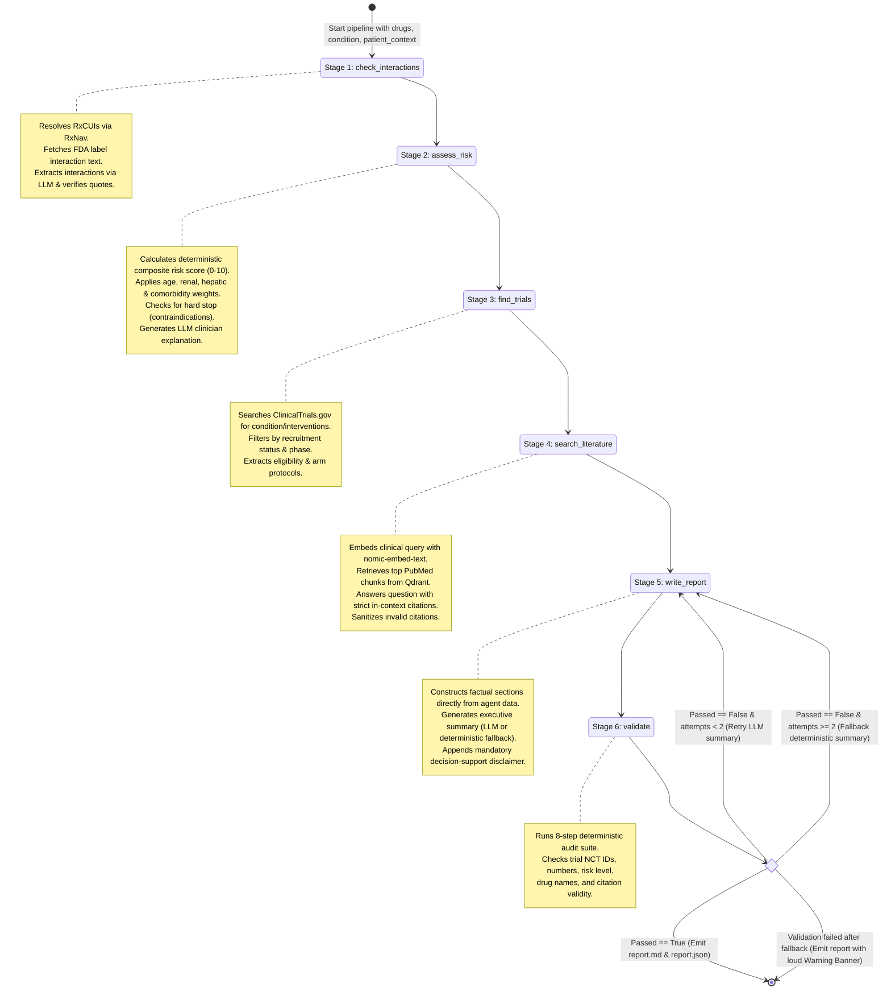
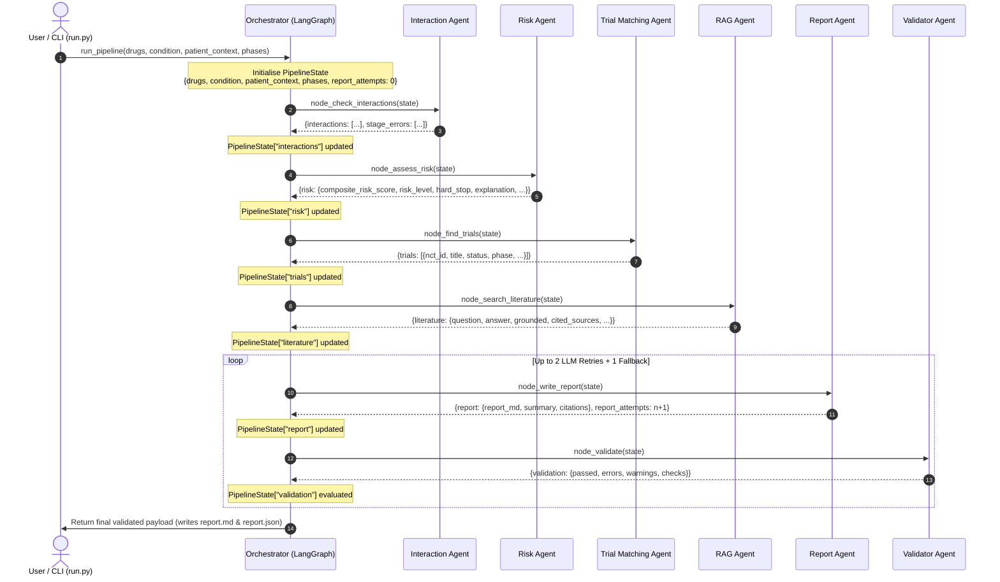
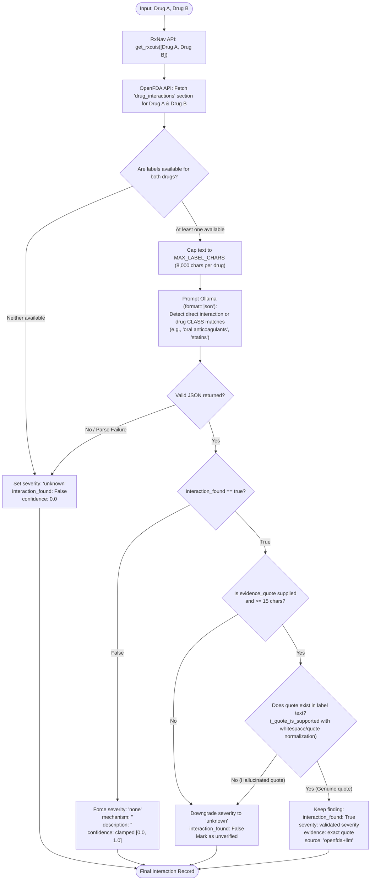
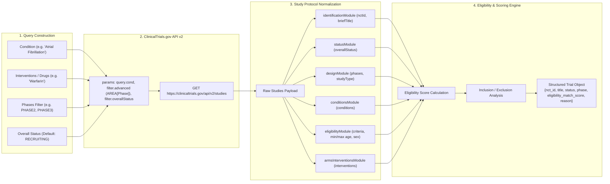
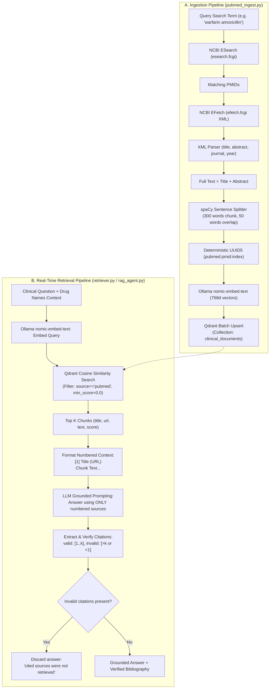
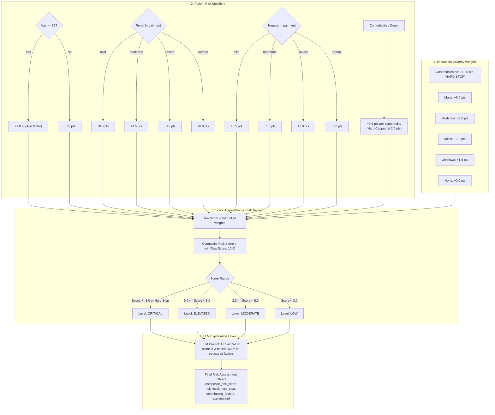
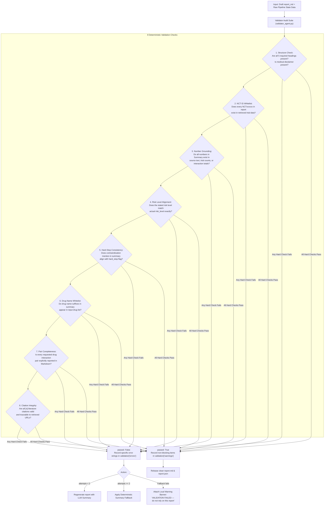

# DrugTrialAI - System Architecture & Component Diagrams

This document contains comprehensive visual diagrams representing the architecture, agent pipelines, data flows, validation loops, and scoring engines of the **Multi-Agent Autonomous Clinical Trial & Drug Interaction Analyzer (DrugTrialAI)**.

All diagrams are authored in standard Mermaid syntax for direct rendering in GitHub, Antigravity, and compatible Markdown viewers.

---

## 1. High-Level System Architecture

The following diagram illustrates the layered architecture of DrugTrialAI, spanning from client entrypoints, the multi-agent orchestrator, specialized agent workers, local inference/embedding services, external clinical knowledge sources, and the final validation gateway.

```mermaid
graph TB
    subgraph ClientLayer ["1. Client & Invocation Layer"]
        CLI["CLI Entrypoint (run.py)"]
        API["FastAPI Gateway (Target / Future)"]
    end

    subgraph OrchestrationLayer ["2. Multi-Agent Orchestrator (LangGraph)"]
        Orchestrator["Orchestrator Engine (core_engine/agents/orchestrator.py)"]
        State["Shared State: PipelineState (TypedDict)"]
    end

    subgraph AgentLayer ["3. Specialized Agent Cluster"]
        InteractionAgent["Drug Interaction Agent\n(OpenFDA + RxNav + LLM)"]
        RiskAgent["Risk Assessment Agent\n(Deterministic Rules + LLM)"]
        TrialAgent["Trial Matching Agent\n(ClinicalTrials.gov API v2)"]
        RAGAgent["Literature RAG Agent\n(PubMed + Vector Retrieval)"]
        ReportAgent["Report Assembler Agent\n(Structured Generator + LLM Summary)"]
        ValidatorAgent["Validator & Critic Agent\n(Anti-Hallucination Gate)"]
    end

    subgraph LocalInference ["4. Free Local Inference & Vector Layer"]
        OllamaLLM["Local LLM: Ollama (phi3:mini / llama3.1)"]
        OllamaEmbed["Local Embeddings: nomic-embed-text (768d)"]
        QdrantDB[("Qdrant Vector DB\n(Collection: clinical_documents)")]
    end

    subgraph ExternalSources ["5. External Public APIs ($0 Free Tier)"]
        RxNavAPI["NLM RxNav REST API\n(RxCUI resolution)"]
        OpenFDAAPI["OpenFDA Drug Label API\n(Official Package Inserts)"]
        ClinTrialsAPI["ClinicalTrials.gov REST API v2\n(Active Studies & Protocols)"]
        PubMedAPI["NCBI Entrez E-Utilities\n(ESearch + EFetch XML)"]
    end

    subgraph OutputLayer ["6. Verified Deliverables & Audit Trail"]
        ReportMD["report.md (Clinician Markdown Report)"]
        ReportJSON["report.json (Audit Trail & Structured Payload)"]
    end

    %% Invocations
    CLI --> Orchestrator
    API -.-> Orchestrator
    Orchestrator <--> State

    %% Orchestrator to Agents
    Orchestrator --> InteractionAgent
    Orchestrator --> RiskAgent
    Orchestrator --> TrialAgent
    Orchestrator --> RAGAgent
    Orchestrator --> ReportAgent
    Orchestrator --> ValidatorAgent

    %% Agent External & Local Connections
    InteractionAgent --> RxNavAPI
    InteractionAgent --> OpenFDAAPI
    InteractionAgent --> OllamaLLM

    RiskAgent --> OllamaLLM

    TrialAgent --> ClinTrialsAPI

    RAGAgent --> QdrantDB
    RAGAgent --> OllamaEmbed
    RAGAgent --> OllamaLLM

    ReportAgent --> OllamaLLM

    %% Validation to outputs
    ValidatorAgent --> Orchestrator
    Orchestrator --> ReportMD
    Orchestrator --> ReportJSON
```

---

## 2. LangGraph Execution DAG & Validation Retry Loop

The orchestrator executes agents in a deterministic sequence to respect local compute constraints (one Ollama instance). If the output fails semantic and factual validation, it loops back to regenerate the report (up to 2 LLM attempts) before falling back to a deterministic summary.

---

## 3. Data Flow & Shared State Lifecycle (`PipelineState`)

This sequence diagram details how the shared `PipelineState` TypedDict evolves across all execution stages.

---

## 4. Drug Interaction & Grounded Evidence Verification Pipeline

To eliminate hallucinations, the Interaction Agent refuses to rely solely on generative LLM memory. It queries official FDA drug labels via OpenFDA and verifies that any finding quotes real text from the label.

---

## 5. Clinical Trial Semantic Search Pipeline

The trial matching pipeline interfaces with ClinicalTrials.gov API v2, filtering active studies and parsing protocol sections.

---

## 6. RAG Subsystem: Ingestion & Hybrid Retrieval Pipeline

The RAG architecture supports scheduled offline ingestion from PubMed and real-time retrieval for clinical literature queries.

---

## 7. Deterministic Risk Scoring Engine Decision Matrix

Risk calculation separates deterministic medical safety scoring from generative language synthesis. The LLM only explains the score; it is mathematically prevented from calculating or modifying it.

---

## 8. Validator Agent & Anti-Hallucination Gate

Every generated report must pass an 8-rule deterministic validation gate before release. If any hard check fails, the report is rejected and routed back to the orchestrator for regeneration.

